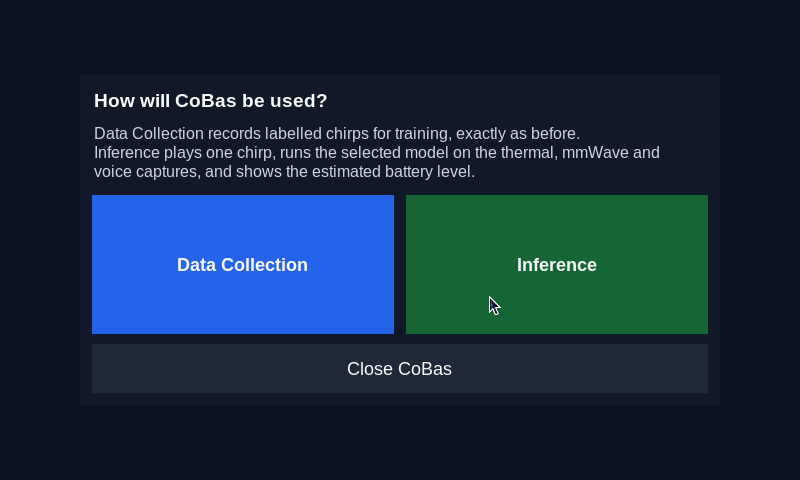
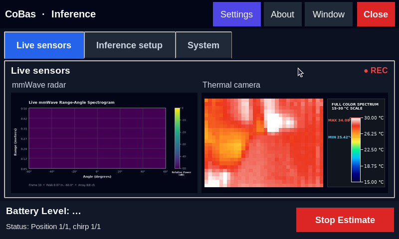
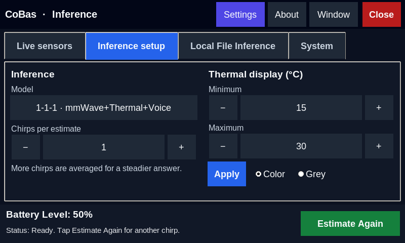
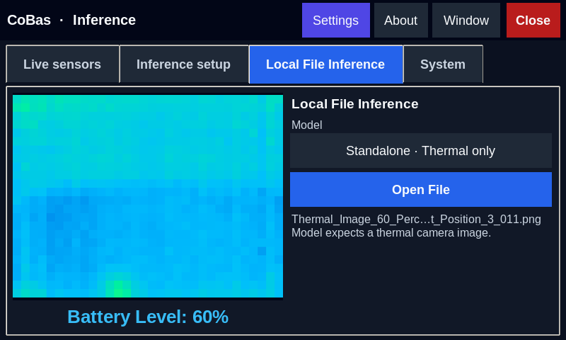
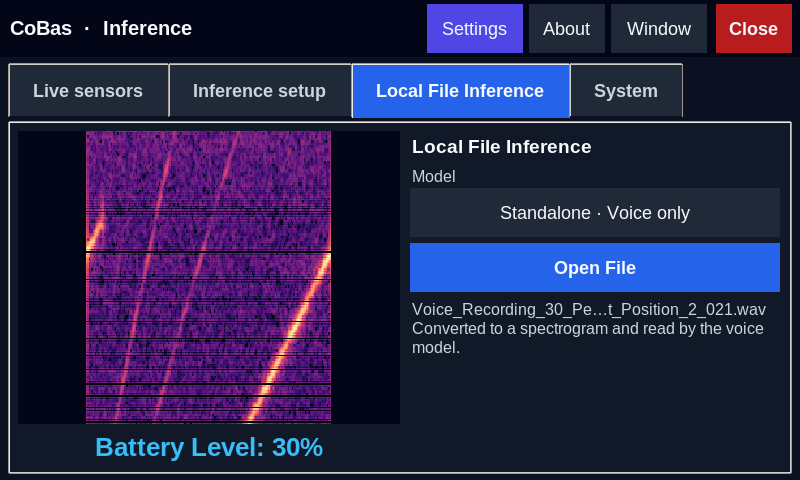
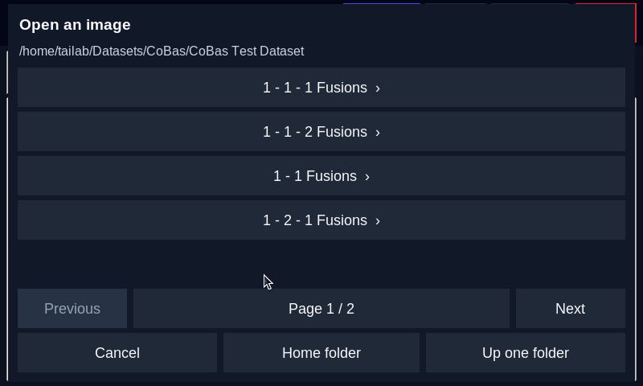

# CoBas

CoBas is a contactless battery sensing prototype. It combines near-ultrasonic
acoustic signals, IWR6843AOP mmWave range-angle responses and synchronized
thermal imaging to estimate the state of charge of a lithium-ion battery
without touching it.

This repository holds the Raspberry Pi app that records and reads a battery,
the inference package behind it, the training notebooks, and the signal
processing tools. The latest test of the app's inference is the
[inference report](#inference-report) below: 1,731 of 1,760 files read
correctly (98.4 %) across the 16 models.

## The Battery Reader app

The app runs on a Raspberry Pi 5 with a touchscreen (today a 3.5-inch 480×320 SPI panel next to an HDMI monitor; the app finds the panel and scales its 800×480 layout to it), a TI IWR6843AOP
mmWave radar, a Melexis MLX90642 thermal camera, a USB speaker and a USB
microphone. Start it from the repository root:

```bash
./run-cobas.sh
```

It asks how it will be used:

- **Data Collection** records labelled chirps for training. For each chirp it
  saves a voice recording, a thermal frame and a mmWave frame under
  `Captures/<N>_Percent_Battery/Session_…/`, optionally pausing between battery
  positions.
- **Inference** plays a chirp, runs the selected model on what the sensors
  captured, and shows "Battery Level: N%". Nothing is kept on disk.
- **Local File Inference**, a tab in Inference mode, estimates the battery
  level of one file already on disk: a thermal image, a mmWave frame, a fused
  image, or a voice recording, which is converted to its spectrogram first.

Set `COBAS_APP_MODE=collect` or `COBAS_APP_MODE=infer` to skip the question.

| | |
|---|---|
|  Choosing the mode |  Live sensors during a chirp |
|  Result of a live estimate |  Local File Inference: a thermal image |
|  A voice recording converted and read |  The touch file browser |

All 21 screenshots are in [`CoBas/Screenshots`](CoBas/Screenshots) and are
described in the [inference README](CoBas/Inference/README.md#screenshots).

## Setting up

The launcher expects a Python virtual environment in `.venv` at the repository
root. Install PyTorch for the CPU, then the packages listed in the two
requirements files:

```bash
.venv/bin/python -m pip install torch torchvision --index-url https://download.pytorch.org/whl/cpu
```

```bash
.venv/bin/python -m pip install -r "CoBas/requirements.txt" -r "CoBas/Inference/requirements.txt"
```

`ffmpeg` and `gcc` must be on the system: the app uses `ffmpeg` for the thermal
video and compiles the thermal camera driver with `gcc`.

The models are not in the repository (about 45 MB each). Copy them to
`CoBas/Inference/models/<folder>/<name>.pth`, keeping the folder names
(`Standalone`, `1 - 1 Fusions`, `1 - 1 - 1 Fusions`, and so on): the folder name
is the fusion ratio. Every model is a PyTorch checkpoint, `.pth` or `.pt`.

## Starting at boot

To have the app start whenever the Pi boots to its desktop, run this once from
the repository root:

```bash
./install-autostart.sh
```

It writes `~/.config/autostart/cobas.desktop`, which the desktop session runs
at login; `./install-autostart.sh --remove` undoes it. The app keeps covering
the touch panel if the screen layout changes after it has started, for example
when an HDMI monitor is detected a little later than the panel at boot.

## Models

There are 16 ResNet-18 checkpoints. Each reads the battery level as one of 11
classes, 0 % to 100 % in steps of 10 %.

| Model | What it reads | Ratios |
|---|---|---|
| CoBas Thermal Model | a thermal camera image | standalone |
| CoBas mmWave Model | a mmWave range-angle frame | standalone |
| CoBas Voice Reflection Recognition Model | the spectrogram of a voice recording | standalone |
| CoBas mmWave Thermal Fusion Model | mmWave and thermal, fused into one image | 1 - 1, 1 - 2, 2 - 1 |
| CoBas mmWave and Voice Fusion Model | mmWave and voice, fused | 1 - 1, 1 - 2, 2 - 1 |
| CoBas Thermal and Voice Model | thermal and voice, fused | 1 - 1, 1 - 2, 2 - 1 |
| CoBas mmWave Thermal Voice Fusion Model | all three, fused | 1 - 1 - 1, 1 - 1 - 2, 1 - 2 - 1, 2 - 1 - 1 |

**What the accuracy figures mean.** The models were trained on recordings made
on one day (2026-10-21), and the report below tests them on files from those
same recordings. On recordings from a different day, tested on 2026-11-07, the
models were at chance (about 9 %). The app and its pipeline work; the models
need more recording sessions before their readings can be trusted on a new
day. The figures are in the
[inference README](CoBas/Inference/README.md#phase-1-results-2026-11-07-raspberry-pi-5).

## Inference report

Test of the Battery Reader app's inference on the CoBas Latest Dataset, run on
2026-11-09 on the Raspberry Pi 5 (aarch64, Python 3.13.5, PyTorch 2.15.0 CPU, 4 threads)
after every model was made a PyTorch checkpoint.

### Result

- **1,731 of 1,760 files read correctly (98.4 %)**, with 0 errors, across 16 models.
  The 29 misses are 1.6 % of the files.
- 10 of the 16 models read every one of their files (100.0 %); the lowest is 90.9 %.
- On the real app screen, one file per model: **16 of 16 (100.0 %)** read-outs matched.
- All 110 voice recordings (100.0 %) were converted to spectrograms by the app and read correctly.
- A live estimate on the real sensors ran end to end with the default model and showed "Battery Level: 50%".

The models were trained on the same Oct 21 recordings this dataset is made from,
so these figures show that the app runs every model correctly on them. They do
not show how the models would do on a new recording day.

### Model files

All 16 models are PyTorch checkpoints with the `.pth` extension (`.pt` is accepted
as well). Before this test the 1 - 1 - 1 folder also held an ONNX copy of its
checkpoint, and the app used that copy for live estimates by default. It was
compared with the `.pth` beside it on that model's 110 dataset files (the same
answer on all 110; largest probability difference 5.75e-08) and then removed,
together with the ONNX loading and export code. The default model for live
estimates is now the `.pth` checkpoint.

### What was tested

The dataset is `~/Datasets/CoBas/CoBas Latest Dataset`: for each of the 16 models,
10 files for each of the 11 battery levels (0 % to 100 %), 110 per model. The
standalone models' files are unchanged copies of saved thermal frames, mmWave
frames and voice recordings; the fusion models' files are fused images made with
each checkpoint's own weights. The expected answer is the battery level in the
folder name.

1. **Every file.** All 1,760 files went through the app's Local File Inference
   code, the part behind the screen that loads the chosen model, converts a
   voice recording to its spectrogram and classifies the file. Each file was
   read by its own model.
2. **The screen.** The real app was run on the Pi's display. For each model the
   model was chosen with the picker's buttons and one file from its folder was
   opened with the file browser's buttons, each at a different battery level.
3. **A live estimate.** "Start Estimate" was pressed once with the default
   model: the radar, thermal camera, speaker and microphone captured one chirp
   and the app classified it.

### Results by model

| Models sub-folder | Model | Checkpoint | Correct of 110 | Accuracy | Time per file |
|---|---|---|---|---|---|
| Standalone | CoBas mmWave Model | `CoBas_mmWave_model.pth` | 110 | 100.0 % | 433 ms |
| Standalone | CoBas Thermal Model | `CoBas_thermal_model.pth` | 107 | 97.3 % | 161 ms |
| Standalone | CoBas Voice Reflection Recognition Model | `CoBas_voice_reflection_recognition_model.pth` | 110 | 100.0 % | 241 ms |
| 1 - 1 Fusions | CoBas mmWave Thermal Fusion Model | `CoBas_mmwave_thermal_fusion_model.pth` | 110 | 100.0 % | 145 ms |
| 1 - 1 Fusions | CoBas mmWave and Voice Fusion Model | `CoBas_mmwave_and_voice_fusion_model.pth` | 109 | 99.1 % | 149 ms |
| 1 - 1 Fusions | CoBas Thermal and Voice Model | `CoBas_thermal_and_voice_model.pth` | 106 | 96.4 % | 153 ms |
| 1 - 2 Fusions | CoBas mmWave Thermal Fusion Model | `CoBas_mmwave_thermal_fusion_model.pth` | 110 | 100.0 % | 150 ms |
| 1 - 2 Fusions | CoBas mmWave and Voice Fusion Model | `CoBas_mmwave_and_voice_fusion_model.pth` | 110 | 100.0 % | 149 ms |
| 1 - 2 Fusions | CoBas Thermal and Voice Model | `CoBas_thermal_and_voice_model.pth` | 102 | 92.7 % | 152 ms |
| 2 - 1 Fusions | CoBas mmWave Thermal Fusion Model | `CoBas_mmwave_thermal_fusion_model.pth` | 110 | 100.0 % | 155 ms |
| 2 - 1 Fusions | CoBas mmWave and Voice Fusion Model | `CoBas_mmwave_and_voice_fusion_model.pth` | 107 | 97.3 % | 154 ms |
| 2 - 1 Fusions | CoBas Thermal and Voice Model | `CoBas_thermal_and_voice_model.pth` | 100 | 90.9 % | 154 ms |
| 1 - 1 - 1 Fusions | CoBas mmWave Thermal Voice Fusion Model | `CoBas_mmwave_thermal_voice_fusion_model.pth` | 110 | 100.0 % | 154 ms |
| 1 - 1 - 2 Fusions | CoBas mmWave Thermal Voice Fusion Model | `CoBas_mmwave_thermal_voice_fusion_model.pth` | 110 | 100.0 % | 154 ms |
| 1 - 2 - 1 Fusions | CoBas mmWave Thermal Voice Fusion Model | `CoBas_mmwave_thermal_voice_fusion_model.pth` | 110 | 100.0 % | 164 ms |
| 2 - 1 - 1 Fusions | CoBas mmWave Thermal Voice Fusion Model | `CoBas_mmwave_thermal_voice_fusion_model.pth` | 110 | 100.0 % | 155 ms |
| | **All 16 models** | | **1,731 of 1,760** | **98.4 %** | |

Time per file is the whole step on the Pi: reading the file, preparing it
(for a voice recording, computing the spectrogram) and running the network.

### Results by model type

The same results with the fusion ratios of each model type added together.

| Model type | Models | Correct | Accuracy |
|---|---|---|---|
| CoBas Thermal Model | 1 | 107 of 110 | 97.3 % |
| CoBas mmWave Model | 1 | 110 of 110 | 100.0 % |
| CoBas Voice Reflection Recognition Model | 1 | 110 of 110 | 100.0 % |
| CoBas mmWave Thermal Fusion Model | 3 | 330 of 330 | 100.0 % |
| CoBas mmWave and Voice Fusion Model | 3 | 326 of 330 | 98.8 % |
| CoBas Thermal and Voice Model | 3 | 308 of 330 | 93.3 % |
| CoBas mmWave Thermal Voice Fusion Model | 4 | 440 of 440 | 100.0 % |
| **All** | **16** | **1,731 of 1,760** | **98.4 %** |

### Results by battery level

| Battery level | Correct of 160 | Accuracy |
|---|---|---|
| 0 % | 160 | 100.0 % |
| 10 % | 160 | 100.0 % |
| 20 % | 149 | 93.1 % |
| 30 % | 159 | 99.4 % |
| 40 % | 160 | 100.0 % |
| 50 % | 160 | 100.0 % |
| 60 % | 149 | 93.1 % |
| 70 % | 159 | 99.4 % |
| 80 % | 157 | 98.1 % |
| 90 % | 158 | 98.8 % |
| 100 % | 160 | 100.0 % |
| **All levels** | **1,731 of 1,760** | **98.4 %** |

Each level has 160 files: 10 for each of the 16 models.

### The 29 misses

| Model | File | Recorded | Read as |
|---|---|---|---|
| Standalone / CoBas Thermal Model | `Thermal_Image_80_Percent_Position_2_001.png` | 80 % | 100 % |
| Standalone / CoBas Thermal Model | `Thermal_Image_80_Percent_Position_2_021.png` | 80 % | 100 % |
| Standalone / CoBas Thermal Model | `Thermal_Image_80_Percent_Position_2_041.png` | 80 % | 100 % |
| 1 - 1 Fusions / CoBas mmWave and Voice Fusion Model | `Fused_Image_20_Percent_Position_4_001.png` | 20 % | 30 % |
| 1 - 1 Fusions / CoBas Thermal and Voice Model | `Fused_Image_20_Percent_Position_1_011.png` | 20 % | 10 % |
| 1 - 1 Fusions / CoBas Thermal and Voice Model | `Fused_Image_20_Percent_Position_3_011.png` | 20 % | 10 % |
| 1 - 1 Fusions / CoBas Thermal and Voice Model | `Fused_Image_20_Percent_Position_3_031.png` | 20 % | 30 % |
| 1 - 1 Fusions / CoBas Thermal and Voice Model | `Fused_Image_20_Percent_Position_4_041.png` | 20 % | 30 % |
| 1 - 2 Fusions / CoBas Thermal and Voice Model | `Fused_Image_60_Percent_Position_2_001.png` | 60 % | 100 % |
| 1 - 2 Fusions / CoBas Thermal and Voice Model | `Fused_Image_60_Percent_Position_2_041.png` | 60 % | 100 % |
| 1 - 2 Fusions / CoBas Thermal and Voice Model | `Fused_Image_60_Percent_Position_3_011.png` | 60 % | 100 % |
| 1 - 2 Fusions / CoBas Thermal and Voice Model | `Fused_Image_60_Percent_Position_4_001.png` | 60 % | 100 % |
| 1 - 2 Fusions / CoBas Thermal and Voice Model | `Fused_Image_60_Percent_Position_4_021.png` | 60 % | 100 % |
| 1 - 2 Fusions / CoBas Thermal and Voice Model | `Fused_Image_70_Percent_Position_4_041.png` | 70 % | 80 % |
| 1 - 2 Fusions / CoBas Thermal and Voice Model | `Fused_Image_90_Percent_Position_2_001.png` | 90 % | 100 % |
| 1 - 2 Fusions / CoBas Thermal and Voice Model | `Fused_Image_90_Percent_Position_4_001.png` | 90 % | 100 % |
| 2 - 1 Fusions / CoBas mmWave and Voice Fusion Model | `Fused_Image_20_Percent_Position_4_001.png` | 20 % | 30 % |
| 2 - 1 Fusions / CoBas mmWave and Voice Fusion Model | `Fused_Image_20_Percent_Position_4_041.png` | 20 % | 30 % |
| 2 - 1 Fusions / CoBas mmWave and Voice Fusion Model | `Fused_Image_30_Percent_Position_4_001.png` | 30 % | 20 % |
| 2 - 1 Fusions / CoBas Thermal and Voice Model | `Fused_Image_20_Percent_Position_1_011.png` | 20 % | 30 % |
| 2 - 1 Fusions / CoBas Thermal and Voice Model | `Fused_Image_20_Percent_Position_3_011.png` | 20 % | 30 % |
| 2 - 1 Fusions / CoBas Thermal and Voice Model | `Fused_Image_20_Percent_Position_4_001.png` | 20 % | 30 % |
| 2 - 1 Fusions / CoBas Thermal and Voice Model | `Fused_Image_20_Percent_Position_4_041.png` | 20 % | 30 % |
| 2 - 1 Fusions / CoBas Thermal and Voice Model | `Fused_Image_60_Percent_Position_2_001.png` | 60 % | 100 % |
| 2 - 1 Fusions / CoBas Thermal and Voice Model | `Fused_Image_60_Percent_Position_2_041.png` | 60 % | 100 % |
| 2 - 1 Fusions / CoBas Thermal and Voice Model | `Fused_Image_60_Percent_Position_3_011.png` | 60 % | 90 % |
| 2 - 1 Fusions / CoBas Thermal and Voice Model | `Fused_Image_60_Percent_Position_4_001.png` | 60 % | 100 % |
| 2 - 1 Fusions / CoBas Thermal and Voice Model | `Fused_Image_60_Percent_Position_4_021.png` | 60 % | 100 % |
| 2 - 1 Fusions / CoBas Thermal and Voice Model | `Fused_Image_60_Percent_Position_4_041.png` | 60 % | 100 % |

The Thermal and Voice models account for 22 of them (75.9 %), the mmWave and
Voice models for 4 (13.8 %) and the Thermal model for 3 (10.3 %). By battery
level, 11 are at 20 % and 11 at 60 % (75.9 % between them). These are the models' own errors: the two
weakest models give the same counts (102 and 100) when the raw chirps are
classified directly, and a fused image opened from disk reaches the network
exactly as the chirp would.

### The screen check

| Model chosen in the picker | File opened | Folder says | Screen showed | Seconds |
|---|---|---|---|---|
| Standalone · mmWave only (pth) | `mmWave_Frame_30_Percent_Position_1_011.jpg` | 30 % | 30 % | 0.8 |
| Standalone · Thermal only (pth) | `Thermal_Image_70_Percent_Position_2_021.png` | 70 % | 70 % | 0.2 |
| Standalone · Voice only (pth) | `Voice_Recording_0_Percent_Position_3_031.wav` | 0 % | 0 % | 1.4 |
| 1 - 1 Fusions · mmWave + Thermal (pth) | `Fused_Image_40_Percent_Position_4_041.png` | 40 % | 40 % | 0.6 |
| 1 - 1 Fusions · mmWave + Voice (pth) | `Fused_Image_80_Percent_Position_2_001.png` | 80 % | 80 % | 0.2 |
| 1 - 1 Fusions · Thermal + Voice (pth) | `Fused_Image_10_Percent_Position_3_011.png` | 10 % | 10 % | 0.2 |
| 1 - 2 Fusions · mmWave + Thermal (pth) | `Fused_Image_50_Percent_Position_4_021.png` | 50 % | 50 % | 0.2 |
| 1 - 2 Fusions · mmWave + Voice (pth) | `Fused_Image_90_Percent_Position_1_031.png` | 90 % | 90 % | 0.2 |
| 1 - 2 Fusions · Thermal + Voice (pth) | `Fused_Image_20_Percent_Position_2_041.png` | 20 % | 20 % | 0.2 |
| 2 - 1 Fusions · mmWave + Thermal (pth) | `Fused_Image_60_Percent_Position_4_001.png` | 60 % | 60 % | 0.2 |
| 2 - 1 Fusions · mmWave + Voice (pth) | `Fused_Image_100_Percent_Position_1_011.png` | 100 % | 100 % | 0.2 |
| 2 - 1 Fusions · Thermal + Voice (pth) | `Fused_Image_30_Percent_Position_2_021.png` | 30 % | 30 % | 0.3 |
| 1 - 1 - 1 Fusions · mmWave + Thermal + Voice (pth) | `Fused_Image_70_Percent_Position_3_031.png` | 70 % | 70 % | 0.2 |
| 1 - 1 - 2 Fusions · mmWave + Thermal + Voice (pth) | `Fused_Image_0_Percent_Position_4_041.png` | 0 % | 0 % | 0.2 |
| 1 - 2 - 1 Fusions · mmWave + Thermal + Voice (pth) | `Fused_Image_40_Percent_Position_2_001.png` | 40 % | 40 % | 0.2 |
| 2 - 1 - 1 Fusions · mmWave + Thermal + Voice (pth) | `Fused_Image_80_Percent_Position_3_011.png` | 80 % | 80 % | 0.2 |

All 16 read-outs matched (100.0 %). Seconds run from the file being tapped to
the read-out. In most rows the model was already in memory, because choosing a
model re-reads the file that is open, so these times are mostly the reading
itself. No pointer or keyboard input reached the app during the run.

### The live estimate

- Model: 1 - 1 - 1 Fusions · mmWave + Thermal + Voice (pth) (`CoBas_mmwave_thermal_voice_fusion_model.pth`), the app's default.
- Read-out: "Battery Level: 50%", 7.3 seconds after pressing Start Estimate.
- Nothing was left on disk: the temporary capture folder was removed.

The charge of the battery on the rig was not known to the test, so this shows
that the live path works with the `.pth` model, not that the reading is right.

### Repeating the test

```bash
.venv/bin/python -m cobas_inference check-latest-dataset "/home/tailab/Datasets/CoBas/CoBas Latest Dataset"
```

run from `CoBas/Inference` classifies every file with its own model and prints
the count and the misses for each model. It takes about five and a half minutes
on the Pi.

The same report is kept on its own in
[`CoBas/Inference/INFERENCE_REPORT.md`](CoBas/Inference/INFERENCE_REPORT.md).

## What is in this repository

| Folder | Contents |
|---|---|
| `CoBas/CoBas Battery Reader V1.0 App` | the touchscreen app: capture, live inference and Local File Inference |
| `CoBas/Inference` | the `cobas_inference` package and command line, its [README](CoBas/Inference/README.md) and the inference report |
| `CoBas/Screenshots` | screenshots of the app taken on the Pi |
| `CoBas/Machine Learning` | the training notebooks |
| `CoBas/mmWave` | radar configuration, raw I/Q logging and range-angle processing |
| `CoBas/Hardware` | the standalone thermal camera scripts and the MLX90642 driver |
| `CoBas/Pulse Generation` | the chirp generators |
| `CoBas/Voice Processing`, `CoBas/Video Processing`, `CoBas/Dataset Tools` | preprocessing pipelines |
| `Old Code` | code from the earlier papers |

The [inference README](CoBas/Inference/README.md) has the detail: the command
line (`replay`, `build-latest-dataset`, `check-latest-dataset`), each model's
preprocessing recipe, how Local File Inference treats each kind of file, and
the list of reliability fixes made to the app.

## Authors

Deniz Karya Acikbas, Pedro Callado de Paiva, Selase Doku, Nitin Shankar Madhu,
Chuka Ezeoke, Clark Friese, Ahmad Jayeb, Lucas Hammermeister, Ningyue Mao,
Xuan Zhou and Xiao Zhang.

© 2026 Trustworthy AIoT Lab, University of Michigan-Dearborn. All rights reserved.
